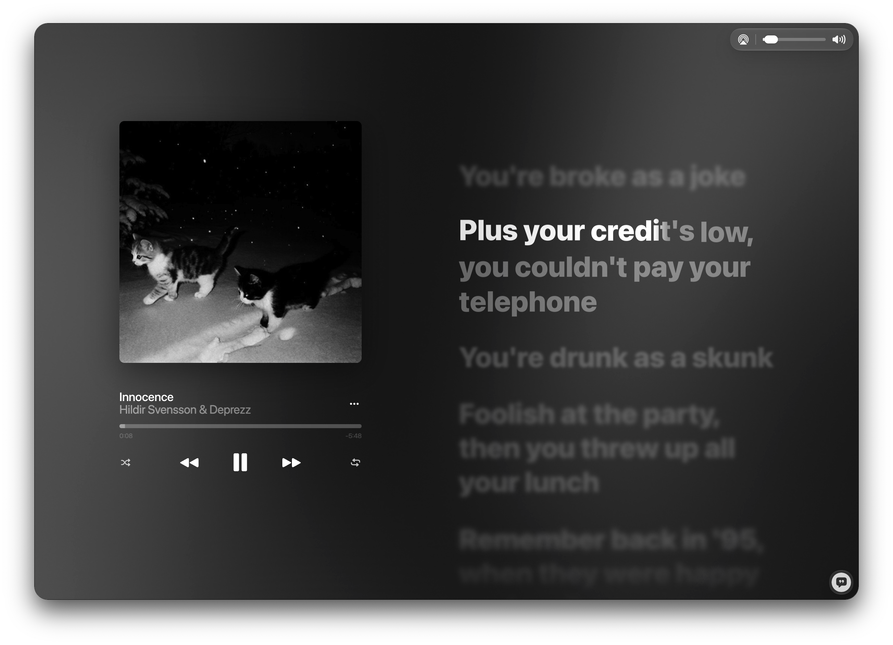
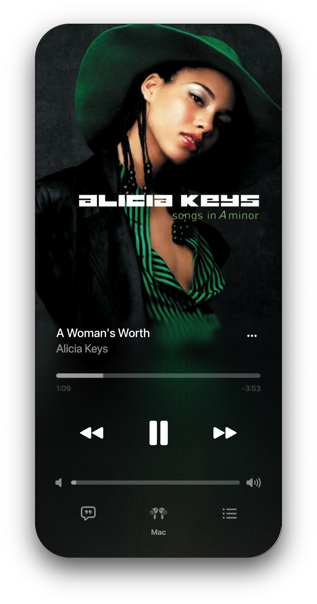
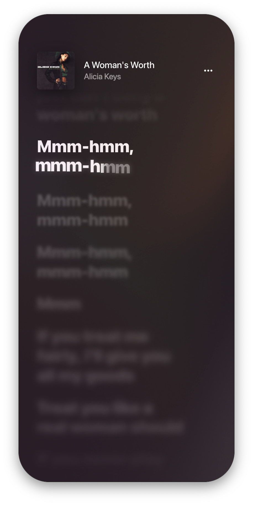

# yourLyrics

An Apple Music-inspired desktop now-playing panel and word-synced lyrics overlay for macOS, Windows, and Linux, built with Electron.

## Showcase



<p align="center">
  
  
</p>

## Download

Download the latest build from [yourlyrics.necois.fun](https://yourlyrics.necois.fun) or the [releases page](https://github.com/nurislamaibekuly/yourLyrics/releases/latest).

> [!WARNING]
> Windows and Linux builds are untested and may not work as expected.

## Features

- System now-playing support via MediaRemote (macOS), SMTC (Windows), and MPRIS (Linux)
- Word-synced karaoke lyrics, backing vocals, instrumental interludes, and TTML / QRC / ELRC / LRC parsing
- Artwork-driven mesh backdrop reacting to live audio energy
- Switchable macOS, iOS portrait, iPadOS, and tvOS layouts
- Discord Rich Presence and GitHub auto-updates

## Project Layout

```
assets/       App icons, bundled fonts, and fallback artwork
images/       Showcase screenshots
scripts/      Build, native helper compilation, and packaging hooks
src/
  main/       Main process (audio, discord, lyrics, media, updates, window)
  preload/    Sandboxed IPC bridge
  renderer/   Renderer UI (lyrics, player, solarium, styles, ui, vendor)
tests/        Unit and Electron integration tests
vendor/       Native audio/media capture helpers
website/      Project website deployed via GitHub Pages
```

## Development

```bash
npm install
npm start
```

### Build

```bash
npm run build:loudness       # macOS CoreAudio tap helper
npm run build:loudness:win   # Windows WASAPI helper
npm run dist:mac             # Package macOS (.zip + latest-mac.yml)
npm run dist:win             # Package Windows (.exe + latest.yml)
npm run dist:linux           # Package Linux (.AppImage + latest-linux.yml)
```

### Tests

```bash
npm run test:lyrics-layout
npm run test:lyrics-compositing
npm run test:playback
npm run test:ios
npm run test:loudness
npm run test:updates
```

## Lyrics Providers & Credits

Thanks to the lyric databases and communities that power yourLyrics:

- [LyricsFlow](https://trylyricsflow.com) — catalog & community TTML lyrics ([Discord](https://discord.gg/zXb7sTJrrq))
- [Unison (Better Lyrics)](https://unison.betterlyrics.org) — community-synced lyrics & curator attribution ([Discord](https://discord.gg/UsHE3d5fWF))
- [Better Lyrics](https://betterlyrics.org) — cached TTML & QQ Music lyrics
- [Paxsenix](https://lyrics.paxsenix.org) — Apple Music & Musixmatch lyrics API
- [LiriQo](https://api.liriqo-alfarrizi.my.id) — multi-provider lyrics aggregator
- [AMLL TTML DB](https://github.com/amll-dev/amll-ttml-db) — open-source TTML lyrics repository
- [LRCLIB](https://lrclib.net) — open-source synced & plain lyrics database

## License

[GNU General Public License v3.0](LICENSE)
